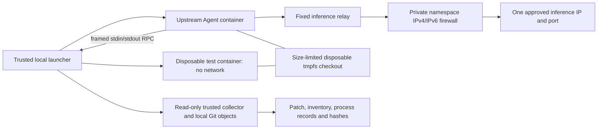

# Phase 5B-A isolated coding worker

Development and review only. No production deployment, Conductor scheduler
integration, new production credential, GitHub write, merge or model reconfiguration.
The research entry point, API/receipt contract, policy and deployment image pins
are unchanged. This extends the existing RPHllc fork based on upstream
`vpontual/veepee-code@8383dc8400e1fae3bf89fb5b20528cabf0d96843`, inherited downstream
base `bcc145002d58075f05969d10562ca52051ecbe03`. Preserve MIT notices and upstream remote.

## Boundary and entry points

`scripts/coding/launcher.py` is a **one-shot local operator executor**, not a server,
scheduler, database or second authorization service. It requires a protected
owner-only operator profile and a strict job request. `dist/coding-worker.js`
uses the existing upstream Agent, OpenAI adapter, ContextManager, permission
manager and immutable WorkerPolicy/ToolRegistry ceiling. No desktop install,
global settings, hooks, project instructions, MCP/remote tools, subagents, memory,
GitHub, direct execution API or shell tools are loaded/enrolled.

The actual upstream coding tools were inspected: they support broad shell/Git,
background processes and host paths. They are deliberately not registered here.
The small audited adapter exposes read/list/literal search, create/edit,
server-approved command IDs, and read-only Git status/diff. Requests cannot select
executable argv, endpoints, images, mounts or permissions. `bash`, ordinary `git`,
`github`, HTTP, Docker, maintenance and external-agent tools are denied at execution.



The launcher is trusted and holds Docker authority **outside** every worker
compartment. No Docker socket is mounted. The agent cannot launch arbitrary
containers; its framed RPC supports fixed commands or read-only Git inspection.
Tests run in a separate container/PID/network namespace, so hostile repository
code cannot access the agent's configuration, inference channel or processes.
The inference relay can reach only the operator's enrolled IPv4 address/port.
It accepts only `/v1/models` and `/v1/chat/completions`, pins the model, rejects
redirects, caps input/response bytes, generations (24) and per-response tokens
(2048). It cannot become a generic HTTP proxy. Inference credentials are not
needed for the existing DGX profile and none are provisioned by this phase.

The relay's namespace is initialized by a short trusted NET_ADMIN helper; neither
the agent, relay nor test code gets that capability. Actual installed IPv4 **and**
IPv6 OUTPUT DROP policies are checked before execution. No DNS is allowed/needed;
operator configuration uses a numeric IPv4 address. The agent is attached only
to a private internal Docker network; executors have `network=none`. A separately
approved bridge may host synthetic inference in tests. No host port is published.

## Filesystem and execution isolation

Each job materializes regular files from the approved repository's **exact full
commit SHA**, importing raw Git objects with no replacement objects, lazy network
fetch, global/system config, hooks, external diffs, textconv or checkout filters.
The original repository is never mounted or modified. The trusted host's separate
Git index supplies actual status/diff. Untrusted execution never sees `.git`.

The workspace is a size-limited tmpfs Docker volume, not an unbounded host bind.
Non-root UID10001 has a read-only image and only that writable data workspace.
IPC is disabled, including Docker's otherwise writable `/dev/shm`; `/tmp` remains
read-only. Standard kernel pseudo-files/devices needed by processes are not
workspace artifacts. No host home, SSH agent/key, Conductor credential, production
repository, host PID namespace or Docker socket is mounted. Capabilities are
dropped, no-new-privileges and Docker's default seccomp are required, CPU/memory/
PID/file-descriptor limits are set, swap is capped and logs use bounded pipes
with Docker logging disabled. Trust the kernel/Docker daemon/operator and pinned
images; this is container isolation, not protection against kernel exploits.

All tool file operations and complete executor lifetimes are serialized, including
parallel model tool batches. Paths are ASCII relative paths with bounded length;
parent traversal, absolute paths, flags, `.git`, common secret names, symlinks,
hardlinks, submodules and special files are rejected. Initial and final snapshots
have at most512 files, 256KiB/file and2MiB total. Binary patch generation is bounded.
Trusted collectors use isolated Python startup (`-I`) and never import repository
code. Optional upstream edit previews and automatic completeness scans are disabled
for policy profiles because those filesystem reads bypass tool path validation.
The default upstream/research prompts and unrestricted profiles retain their behavior.

Only `python_unittest`, `node_test` and `python_syntax` are currently audited command
profiles. The last compiles actual Python source in memory without importing it.
There is no arbitrary shell/argv facility. Python/Node/Git and tools are installed
in the controlled image build, never through job network/package installation.
Additional project dependencies/languages need a separately reviewed image and
fixed command profile; the initial implementation is intentionally these runtimes.

Every command has a kernel/container lifetime, bounded output and independently
observed Docker exit state. Even detached/setsid/double-fork descendants die with
the executor PID namespace. The launcher confirms removal before returning a tool
result. Agent, relay and firewall also have independent lifetimes so launcher
SIGKILL does not create indefinite execution. A passive workspace holder keeps
tmpfs contents available between containers, with at most20 seconds of additional
artifact grace. It executes only trusted sleep, not repository/model code.

## Local use and resources

Build distinct images (do not run `npm run install:local`):

```sh
docker build --target executor --build-arg VCS_REF="$(git rev-parse HEAD)" -f Dockerfile.coding -t vcode-coding-executor:dev .
docker build --target agent --build-arg VCS_REF="$(git rev-parse HEAD)" -f Dockerfile.coding -t vcode-coding-agent:dev .
python3 scripts/coding/test_contract.py
python3 scripts/coding/test_linux.py
```

Use `CODING_DOCKER_CONTEXT=desktop-linux` on the owner's Mac, `default` on CI;
set `CODING_AGENT_IMAGE` / `CODING_EXECUTOR_IMAGE` for other development builds.
The launcher itself accepts only immutable image IDs in its profile. Copy a
profile outside Git with mode0600, create its artifact root mode0700, explicitly
enroll a disposable local repository ID/base SHA and allowed test profiles.
See [the contract and profile example](coding-job-v1.md). OS ownership is local
operator authentication. There is no unauthenticated coding HTTP listener.

`wall_seconds` is5–180 and includes setup, inference and commands;
`command_seconds`1–30 may not exceed it; tool calls1–64; commands at most8 including
required final validation. CPU .1–2, memory128–1024MiB and PID32–128 limits apply
**per unprivileged container**, not as an aggregate job quota. Workspace8–64MiB
is shared across compartments. At most four unprivileged compartments plus one
64MiB/.1CPU/16PID trusted firewall helper are simultaneously active. Results record
conservative aggregate bounds (4× configured CPU/memory/PIDs plus that helper).
The future supervisor must reserve the aggregate, not a single-container value.
Docker/kernel/control-plane overhead is outside those workload cgroup quotas.

Container TTLs round up to a second; teardown/artifact collection is a separate
bounded grace (15 seconds for collection, bounded Docker control calls). If the
Docker daemon is unavailable and stop cannot be verified, state is failed with
`cleanup_unconfirmed`, never completed/cancelled. An inference server may continue
bounded generation after its HTTP connection closes; no claim to control shared
model-server processes is made. Local repository execution is independently stopped.

## Results and interruption

The model's prose is never test evidence. After the agent exits, the launcher
runs every enrolled final validation itself in fresh executor containers, compares
pre/post trees and collects after all mutators stop. A changed validation tree,
nonzero/unknown exit, policy denial, missing model completion or unsafe snapshot
prevents completed state. Test definitions are repository code, so a zero exit is
not a semantic proof: independent acceptance applies the actual patch to the
recorded base and runs external oracles. Patches are not applied to real repositories.

Artifacts include exact base and identities, inventory with SHA256s, binary-safe
Git patch, actual argv/exit codes, stdout (including base64/hash), bounded stderr,
truncation/stop status, test-tree hashes, model/tool diagnostics, model-generated
summary clearly separated, resource/network evidence and artifact hashes.
`artifacts.json` hashes the report, launch manifest, command ledger and patch.
Durable command records are written before dispatch and after observed completion.
A crash may leave an in-progress command with unknown exit, never a fabricated pass.

```sh
python3 scripts/coding/launcher.py run --profile /protected/profile.json --request /protected/request.json
python3 scripts/coding/launcher.py recover --profile /protected/profile.json --attempt '<canonical-attempt-uuid>'
```

Artifact publication uses owner-only unique `.next` staging files, file fsync,
atomic replacement and directory fsync. Recovery ignores interrupted staging bytes
(including legacy fixed-name `.next` files); it never promotes them into evidence.
A published result and its referenced artifacts are immutable during recovery.
A missing final integrity manifest can be reconstructed only after checking the
published artifact hashes; an inconsistent published manifest/artifact is rejected.

An owner-side attempt file lock serializes launcher and recovery. Before every
container/network/volume create, a creation intent is durably published in
`creation-state.json`; only a successful Docker creation acknowledgment clears
that exact intent. Attached execution is separate from acknowledged creation,
including trusted collectors, so a real nonzero process exit is not mistaken for
uncertain creation. A late start cannot resurrect an acknowledged object after
confirmed deletion. These are local execution safeguards, not another scheduler.

Recovery removes known resources and re-enumerates, but an empty list alone is
**never** stop proof: a Docker CLI or queued daemon create may outlive the launcher.
Missing/invalid journals, legacy attempts without a journal, or any unacknowledged
creation retain `cleanup_unconfirmed` even if repeated listings are empty. No quiet
period automatically clears this uncertainty. Repeated recovery still sweeps late
resources and preserves the original unconfirmed result; external operator proof
would be required to release such a fence. This phase adds no automatic override.

Attempt directories are exclusive replay fences. A duplicate submission reports
`attempt_already_exists` with unknown stop state, because the original may still
be running; only explicit recovery may reconcile it. A different attempt is not an
automatic authorized retry; Conductor must own cross-attempt idempotency. SIGTERM
requests cancellation, followed by verified destruction of local executors before
cancelled state. A killed launcher produces no success result; `recover` removes
only the bound attempt's containers/networks/volume, retains available process
records and reports failed/interrupted, unknown diff/duration where lost. It
neither restarts a job nor claims missing tests passed. A missing/unsafe partial
snapshot is explicitly `patch.status=unavailable`. Keep partial evidence as failed,
not as a usable successful result. Cleanup confirmation never implies code correctness.

Exit0 requires completed state, exit1 is a structured unsuccessful result, exit2
is a request/launcher error. A pre-launch validation failure has
`execution_started=false`; an unexpected error after dispatch may have started
reports uncertainty. Never free a future Conductor slot from exit status alone.

## Review and future integration

CI builds amd64 development images and runs actual Linux isolation/coding tests
with synthetic inference, plus the entire existing Vcode suite in its unchanged
research workflow. Evidence and image archives retain exact source/image identities.
They are not production activation evidence. Real-model evaluation is opt-in,
limited to two synthetic jobs; [the evidence record](coding-worker-evidence.md)
distinguishes it from deterministic tests. No research image pin is changed.

See [the proposed Phase 5B-B interface](coding-job-v1.md#proposed-phase-5b-b-interface).
Do not merge/deploy this candidate or start Conductor integration from this PR.
